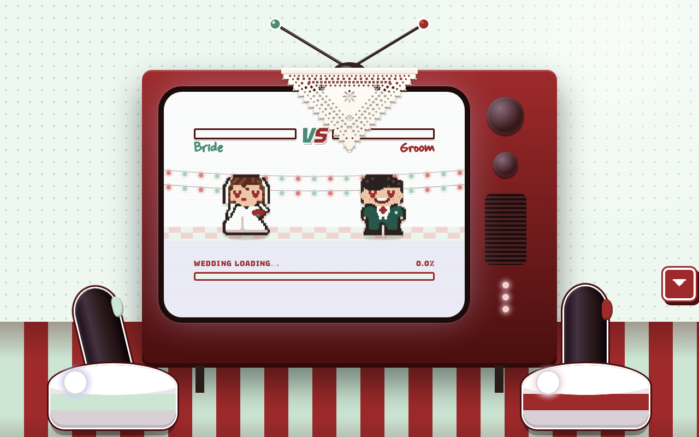
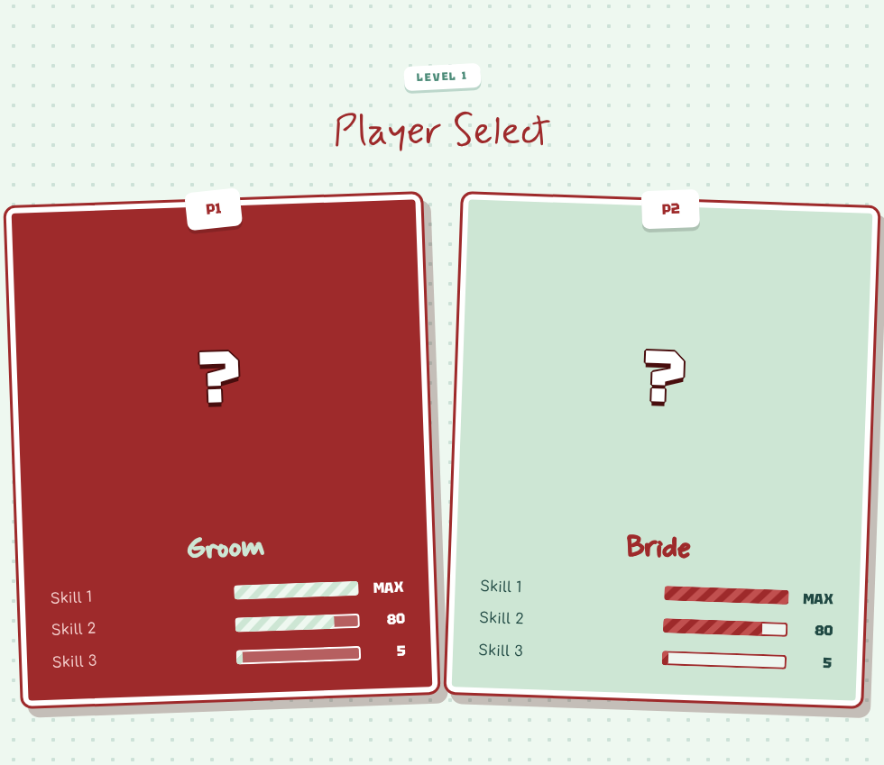
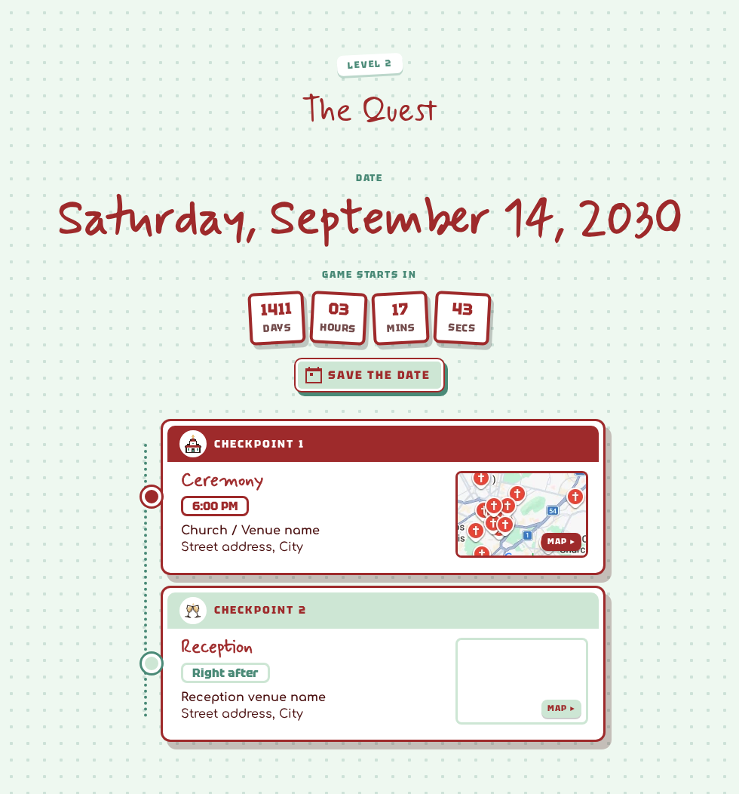
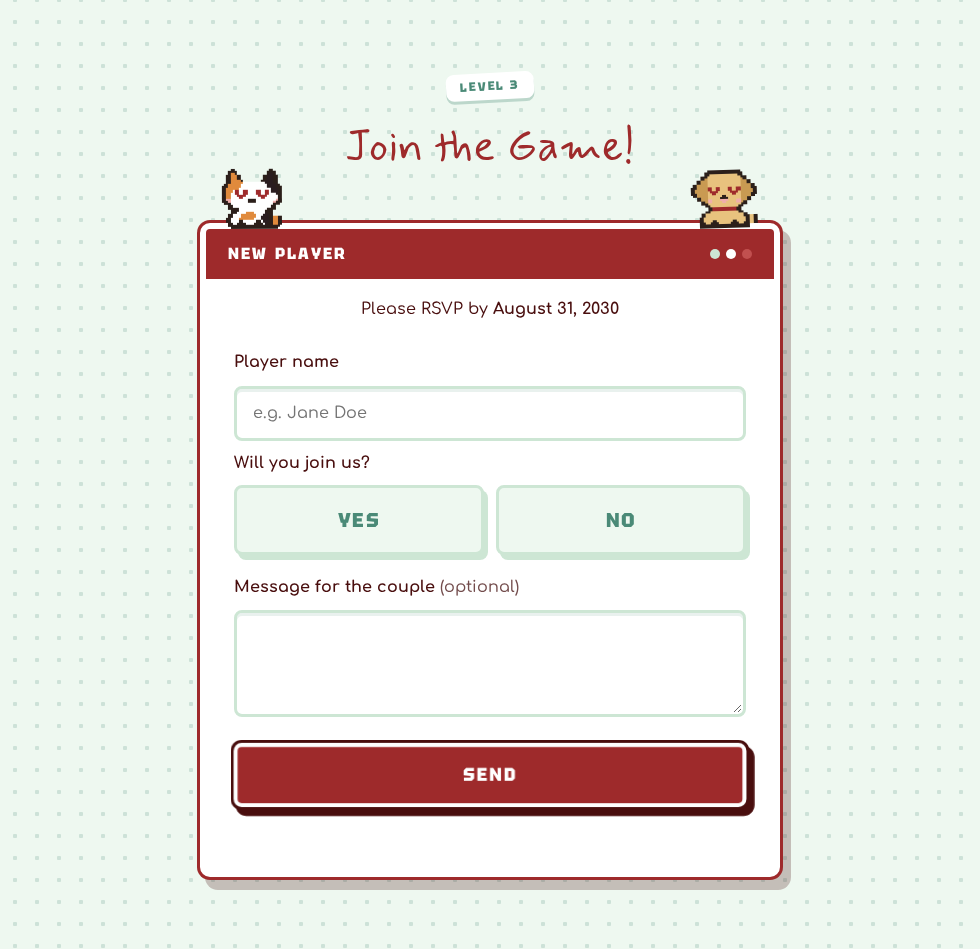
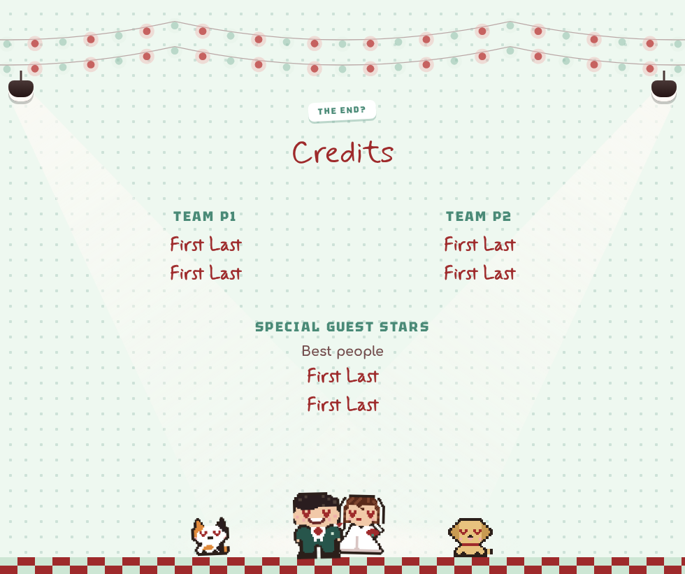
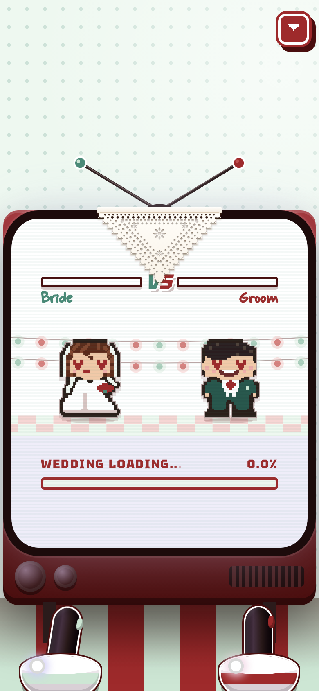

# Retro Arcade Wedding Invitation

An online wedding invitation that looks and plays like a vintage co-op video game: a CRT TV that tunes in,
two joysticks that throw hearts, a "player select" screen, a countdown, checkpoint maps, an RSVP form styled
as a "NEW PLAYER" menu and end credits with a dancing pixel-art couple.

Built as a plain static site (HTML, CSS, JS) with no build step and no dependencies, hosted on GitHub Pages.

## Screenshots

| Player select | The quest |
|---|---|
|  |  |

| RSVP | Credits |
|---|---|
|  |  |

## Features

- **CRT TV intro**: static, a rolling picture and flicker until the signal "locks", then a fighting-game screen with love bars.
- **Joysticks**: tap them to throw hearts at the other player; fill both bars for a PERFECT MATCH.
- **Player select**: photo cards with game-style skills (values above 100 show as a glowing MAX).
- **The quest**: date, live countdown, Save the date (Google Calendar) and checkpoints with embedded maps.
- **RSVP**: yes/no, player counter with names for extra guests and an optional message, saved to a Google Sheet.
- **Credits**: thank-yous rolled like end credits, string lights, spotlights and a slow-dancing couple.
- **8-bit sounds** synthesised in the browser, confetti on YES and support for reduced motion.
- Palette: 50s diner mint + cherry.

## Tech

- Vanilla HTML, CSS and JavaScript, no frameworks or build tools
- Pixel art drawn in code (SVG) and upscaled with the Scale2x algorithm
- 8-bit sound effects generated with the Web Audio API
- RSVP responses stored in Google Sheets through a Google Apps Script web app
- Responsive layout for phones and desktops, with support for reduced motion

## Source code

This repository is a showcase only: it contains the README and screenshots.
The source code is kept in a private repository.
